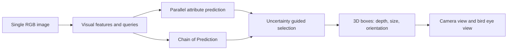

# Neusoft Reach Mono3D

**Monocular 3D detection research workspace with an offline prediction viewer.** Work with single-image RGB detection and turn saved 3D boxes into camera overlays and bird's-eye views that open in a browser.

## Visual preview

[Official detection visualizations](https://alanzhangcs.github.io/monocop-page/#qualitative-results) · [Official project page](https://alanzhangcs.github.io/monocop-page/)

The image below comes from the original authors' project page. It was not produced by a new inference run in this repository:


Download and open the included [offline geometry demo](examples/geometry-demo.html) in a browser. Its **boxes and background are synthetic**: it demonstrates projection and report layout, not model performance.

## Use the viewer without downloading weights

Generating the demo requires only the Python 3 standard library. It does not require PyTorch, a GPU, a dataset, or model weights:

```bash
python3 tools/render_predictions.py \
  --predictions examples/synthetic_predictions.txt \
  --calibration examples/synthetic_calib.txt \
  --synthetic --output examples/geometry-demo.html
```

To visualize existing KITTI-format predictions with your own image:

```bash
python3 tools/render_predictions.py \
  --predictions /path/to/000001.txt \
  --calibration /path/to/calib/000001.txt \
  --image /path/to/image_2/000001.png \
  --width 1242 --height 375 --output report.html
```

Set the dimensions to match the actual image. Input labels or predictions must use KITTI's 15/16-field camera-coordinate format, with dimensions in H/W/L order and positions at the bottom center of each box. Projection uses P2 calibration. The bird's-eye view uses the same camera-coordinate boxes and requires no LiDAR. Its fixed range is ±25 m laterally and 0–50 m forward; objects outside this range may be clipped.

## Upstream reported benchmarks

These are **publicly reported upstream values, not results reproduced by this repository**. No weights or datasets were downloaded, and no training, inference, or model evaluation was performed for this edition.

| Split | Training setup | Car AP3D | Notes |
|---|---|---:|---|
| KITTI validation | Car / Pedestrian / Cyclist | 23.72 | Single value in the upstream model zoo; difficulty is unspecified |
| KITTI validation | Car only | 24.05 | Single value in the upstream model zoo; difficulty is unspecified |
| KITTI test | Official leaderboard result | 19.11 | Moderate, as labeled in the upstream README |

Source: [upstream model zoo](https://github.com/alanzhangcs/MonoCoP#model-zoo). Its validation table has an E/M/H header but provides only one value per row. This table does not infer missing values or assign a difficulty to those entries.

## Method overview

This **conceptual diagram** summarizes the authors' description; it is not a complete network topology.



## Training and model evaluation

Original model directories, configuration names, and entry points are retained to support implementation review and checkpoint compatibility. Prepare a GPU environment, KITTI data, and weights separately; follow the [upstream installation and training instructions](docs/UPSTREAM_README.md). Running the CUDA model on the local macOS machine has not been validated.

```bash
bash train.sh 0 --config config/monocop.yaml
bash test.sh 0 --config config/monocop_test.yaml
```

## Validation and credits

Run the viewer checks with `python3 -m unittest discover -s tests -v`. They cover projection, the near plane, KITTI bottom-center coordinates, invalid numeric values, and HTML escaping. They do not evaluate model accuracy.

[Provenance and changes](docs/PROVENANCE.md) · [Original paper](https://arxiv.org/abs/2503.11651) · [Original README](docs/UPSTREAM_README.md) · [License](LICENSE)

Please cite the original paper when using the algorithm. The added tools are also released under MIT.
