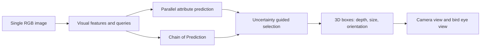

# Neusoft Reach Mono3D

**单目 3D 目标检测与可视化工具。** 用单张 RGB 图像理解场景，将已保存的检测框转换为可离线打开的相机视图与鸟瞰图。

Monocular 3D detection research workspace with an offline prediction viewer.

本版本使用 Neusoft Reach（东软睿驰）名称，发布者已确认获准公开。算法基于 [MonoCoP](https://github.com/alanzhangcs/MonoCoP)（CVPR 2026）的官方 MIT 实现；新增可视化工具、人工样例与中文说明。MonoCoP 的算法与原论文归原作者所有；此仓库不是 MonoCoP 官方发布。

## 先看效果

[官方真实检测可视化](https://alanzhangcs.github.io/monocop-page/#qualitative-results) · [官方项目页](https://alanzhangcs.github.io/monocop-page/)

以下检测图来自原作者项目页，未在本仓库重新推理：


仓库自带 [离线几何演示](examples/geometry-demo.html)，下载后用浏览器打开。它使用**人工构造的框与背景**，展示投影和报告版式，不是模型效果。

## 不下载权重也能使用

生成演示只需要 Python 3 标准库，无需 PyTorch、GPU、数据集或权重：

```bash
python3 tools/render_predictions.py \
  --predictions examples/synthetic_predictions.txt \
  --calibration examples/synthetic_calib.txt \
  --synthetic --output examples/geometry-demo.html
```

已有 KITTI 格式预测文件时，可加入自己的图片：

```bash
python3 tools/render_predictions.py \
  --predictions /path/to/000001.txt \
  --calibration /path/to/calib/000001.txt \
  --image /path/to/image_2/000001.png \
  --width 1242 --height 375 --output report.html
```

尺寸应与实际图片一致。输入为 KITTI 相机坐标的 15/16 列标签或预测，尺寸顺序为 H/W/L，位置是框底面中心；标定使用 P2。鸟瞰图由同一组相机坐标框生成，无需 LiDAR。视图范围固定为横向 ±25 m、前方 0–50 m，边界外物体可能被裁切。

## 官方报告的检测指标

以下是**上游公开报告值，非本仓库复测结果**。本版本未下载权重或数据集，未执行训练、推理或模型评测。

| 数据划分 | 训练设置 | Car AP3D | 说明 |
|---|---|---:|---|
| KITTI validation | Car / Pedestrian / Cyclist | 23.72 | 上游模型库单值，难度口径待核对 |
| KITTI validation | Car only | 24.05 | 上游模型库单值，难度口径待核对 |
| KITTI test | 官方榜单结果 | 19.11 | Moderate，按上游 README 标注 |

来源：[上游模型库](https://github.com/alanzhangcs/MonoCoP#model-zoo)。上游验证表头写 E/M/H，但每行只给一个数，此处不将其补成三项或擅自确定难度。

## 模型思路

下图根据原作者说明重新整理，是**概念图**，不表示完整网络拓扑。



## 训练与模型评测

保留原始模型目录、配置名和训练入口，便于核对实现与兼容权重。GPU 环境、KITTI 数据集和权重由使用者另行准备，详见 [官方安装与训练说明](docs/UPSTREAM_README.md)。本次未验证 CUDA 模型在本机 macOS 上运行。

```bash
bash train.sh 0 --config config/monocop.yaml
bash test.sh 0 --config config/monocop_test.yaml
```

## 验证与来源

新增工具验证：`python3 -m unittest discover -s tests -v`。覆盖投影、近平面、KITTI 框底面中心、非法数值与页面转义；不验证模型精度。

[上游来源与改动范围](docs/PROVENANCE.md) · [原论文](https://arxiv.org/abs/2503.11651) · [原始 README](docs/UPSTREAM_README.md) · [许可证](LICENSE)

引用算法时请引用原论文。新增工具同样按 MIT 发布。
